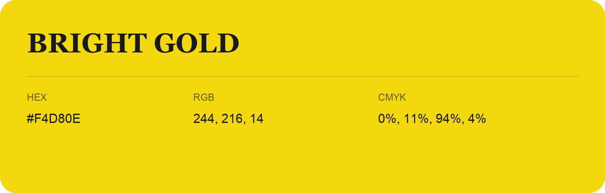

## Bright Gold

- HEX: #F4D80E
- RGB: 244, 216, 14
- CMYK: 0%, 11%, 94%, 4%
- Character: sunny, lively, optimistic
- Suggested uses: friendly consumer brands, food packaging, cheerful accents

- Source images: IMG_8990.JPG
