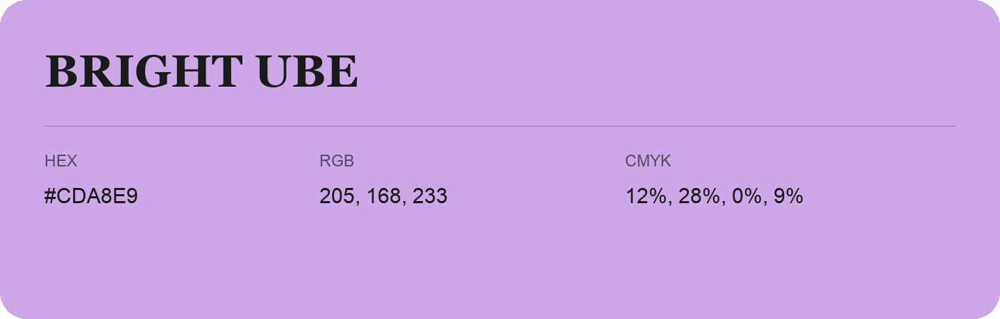

## Bright Ube

- HEX: #CDA8E9
- RGB: 205, 168, 233
- CMYK: 12%, 28%, 0%, 9%
- Character: soft, gentle, approachable
- Suggested uses: friendly consumer brands, gentle backgrounds, welcoming accents

- Source images: IMG_9071.JPG

- Data provenance: RGB calculated from HEX, matching the page; source image RGB was unreadable.
