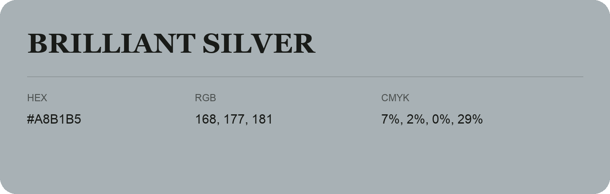

## Brilliant Silver

- HEX: #A8B1B5
- RGB: 168, 177, 181
- CMYK: 7%, 2%, 0%, 29%
- Character: quiet, balanced, understated
- Suggested uses: professional services, minimal identities, supporting backgrounds

- Source images: IMG_9107.JPG
