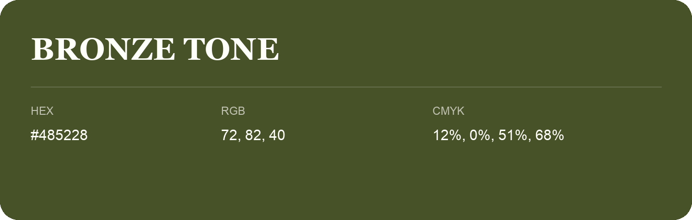

## Bronze Tone

- HEX: #485228
- RGB: 72, 82, 40
- CMYK: 12%, 0%, 51%, 68%
- Character: deep, grounded, understated
- Suggested uses: premium packaging, editorial typography, dark backgrounds

- Source images: iCloud Photos 2/IMG_9142.JPG

- Name note: Other distinct shades share this name: [bronze-tone](bronze-tone.md).
