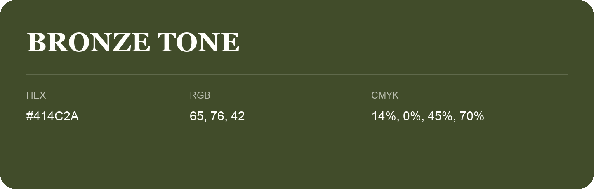

## Bronze Tone

- HEX: #414C2A
- RGB: 65, 76, 42
- CMYK: 14%, 0%, 45%, 70%
- Character: deep, grounded, understated
- Suggested uses: premium packaging, editorial typography, dark backgrounds

- Source images: iCloud Photos 2/IMG_9128.JPG

- Name note: Other distinct shades share this name: [bronze-tone-485228](bronze-tone-485228.md).
