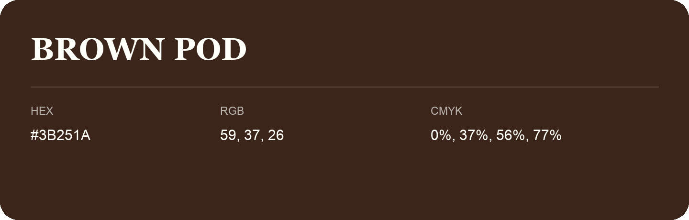

## Brown Pod

- HEX: #3B251A
- RGB: 59, 37, 26
- CMYK: 0%, 37%, 56%, 77%
- Character: deep, grounded, understated
- Suggested uses: premium packaging, editorial typography, dark backgrounds

- Source images: iCloud Photos 2/IMG_9135.JPG
