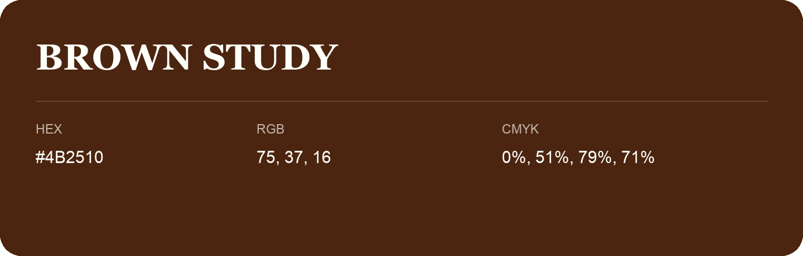

## Brown Study

- HEX: #4B2510
- RGB: 75, 37, 16
- CMYK: 0%, 51%, 79%, 71%
- Character: earthy, rich, warm
- Suggested uses: premium packaging, rustic brands, dark backgrounds

- Source images: IMG_8979.JPG
