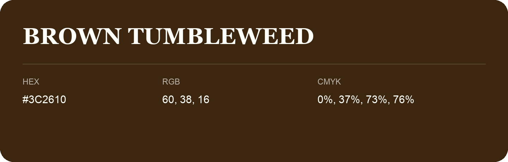

## Brown Tumbleweed

- HEX: #3C2610
- RGB: 60, 38, 16
- CMYK: 0%, 37%, 73%, 76%
- Character: deep, grounded, understated
- Suggested uses: premium packaging, editorial typography, dark backgrounds

- Source images: iCloud Photos 2/IMG_9130.JPG
