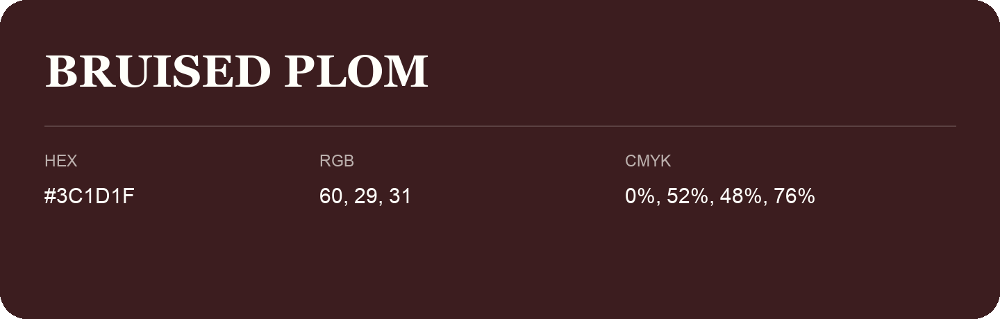

## Bruised Plom

- HEX: #3C1D1F
- RGB: 60, 29, 31
- CMYK: 0%, 52%, 48%, 76%
- Character: warm, expressive, energetic
- Suggested uses: food brands, expressive identities, promotional accents

- Source images: IMG_9078.JPG
