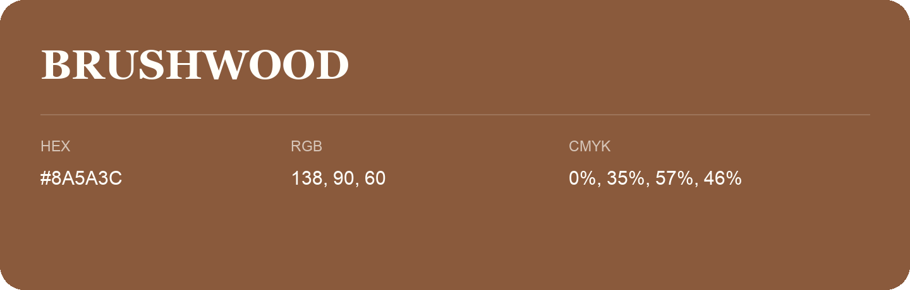

## Brushwood

- HEX: #8A5A3C
- RGB: 138, 90, 60
- CMYK: 0%, 35%, 57%, 46%
- Character: earthy, rich, warm
- Suggested uses: premium packaging, rustic brands, dark backgrounds

- Source images: iCloud Photos 2/IMG_9158.JPG
