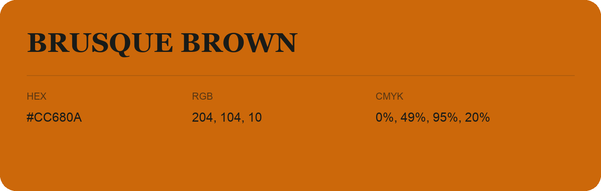

## Brusque Brown

- HEX: #CC680A
- RGB: 204, 104, 10
- CMYK: 0%, 49%, 95%, 20%
- Character: earthy, rich, warm
- Suggested uses: artisan businesses, hospitality brands, warm accents

- Source images: iCloud Photos 2/IMG_9132.JPG
