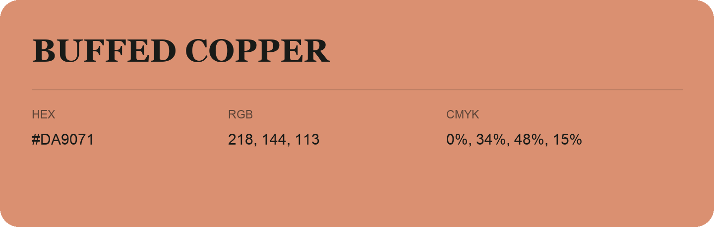

## Buffed Copper

- HEX: #DA9071
- RGB: 218, 144, 113
- CMYK: 0%, 34%, 48%, 15%
- Character: earthy, rich, warm
- Suggested uses: artisan businesses, hospitality brands, warm accents

- Source images: IMG_9114.JPG
