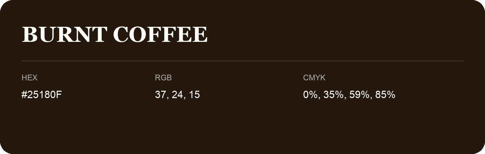

## Burnt Coffee

- HEX: #25180F
- RGB: 37, 24, 15
- CMYK: 0%, 35%, 59%, 85%
- Character: deep, grounded, understated
- Suggested uses: premium packaging, editorial typography, dark backgrounds

- Source images: IMG_9073.JPG

- Name note: Other distinct shades share this name: [burnt-coffee-261c0f](burnt-coffee-261c0f.md), [burnt-coffee-261e10](burnt-coffee-261e10.md).
