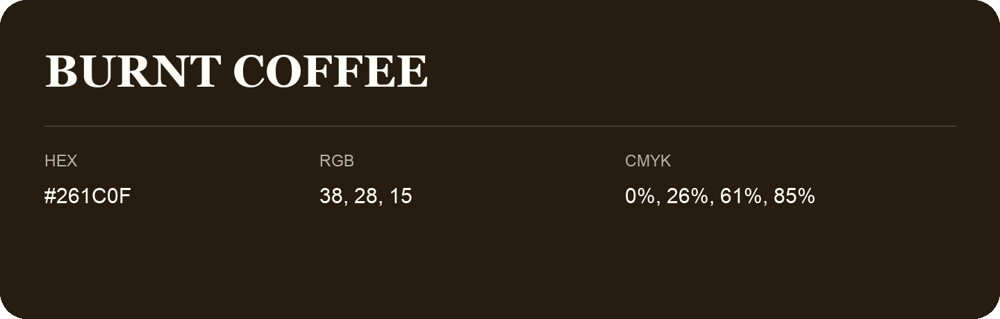

## Burnt Coffee

- HEX: #261C0F
- RGB: 38, 28, 15
- CMYK: 0%, 26%, 61%, 85%
- Character: earthy, rich, warm
- Suggested uses: premium packaging, rustic brands, dark backgrounds

- Source images: IMG_9087.JPG

- Data provenance: HEX recovered from page data; cross-checked against the readable source RGB.

- Name note: Other distinct shades share this name: [burnt-coffee-25180f](burnt-coffee-25180f.md), [burnt-coffee-261e10](burnt-coffee-261e10.md).
