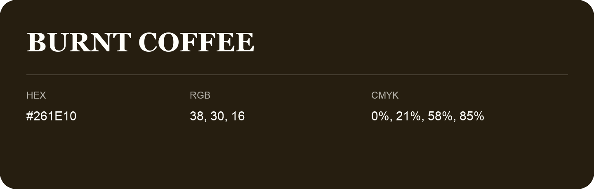

## Burnt Coffee

- HEX: #261E10
- RGB: 38, 30, 16
- CMYK: 0%, 21%, 58%, 85%
- Character: deep, grounded, understated
- Suggested uses: premium packaging, editorial typography, dark backgrounds

- Source images: IMG_9055.JPG

- Name note: Other distinct shades share this name: [burnt-coffee-25180f](burnt-coffee-25180f.md), [burnt-coffee-261c0f](burnt-coffee-261c0f.md).
