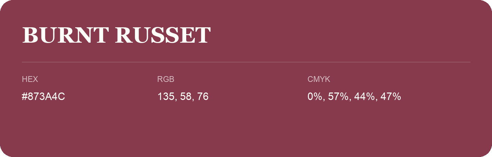

## Burnt Russet

- HEX: #873A4C
- RGB: 135, 58, 76
- CMYK: 0%, 57%, 44%, 47%
- Character: warm, expressive, energetic
- Suggested uses: food brands, expressive identities, promotional accents

- Source images: IMG_9037.JPG
