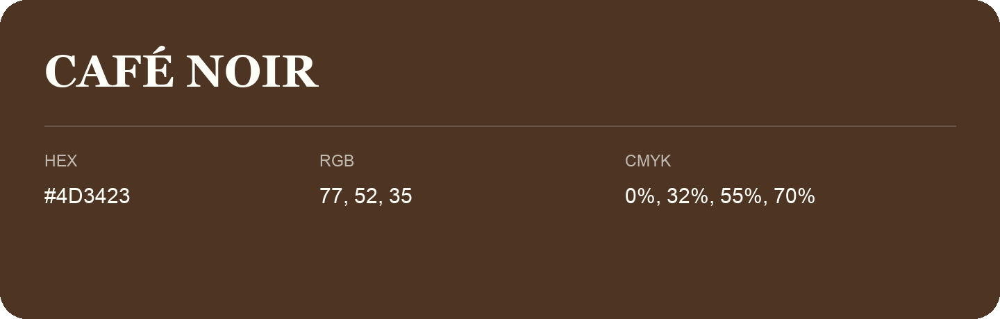

## Café Noir

- HEX: #4D3423
- RGB: 77, 52, 35
- CMYK: 0%, 32%, 55%, 70%
- Character: earthy, rich, warm
- Suggested uses: premium packaging, rustic brands, dark backgrounds

- Source images: IMG_9049.JPG
