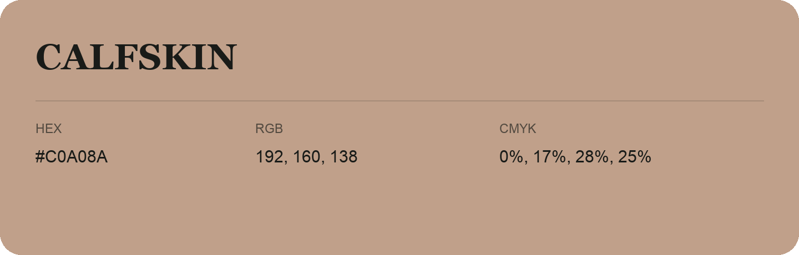

## Calfskin

- HEX: #C0A08A
- RGB: 192, 160, 138
- CMYK: 0%, 17%, 28%, 25%
- Character: soft, gentle, approachable
- Suggested uses: friendly consumer brands, gentle backgrounds, welcoming accents

- Source images: IMG_9020.JPG

- Data provenance: HEX recovered from page data; cross-checked against the readable source RGB.
