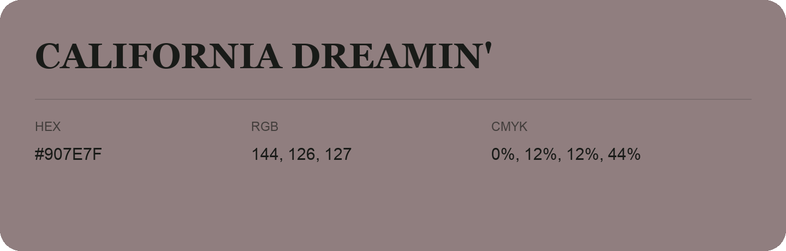

## California Dreamin'

- HEX: #907E7F
- RGB: 144, 126, 127
- CMYK: 0%, 12%, 12%, 44%
- Character: quiet, balanced, understated
- Suggested uses: professional services, minimal identities, supporting backgrounds

- Source images: IMG_9013.JPG
