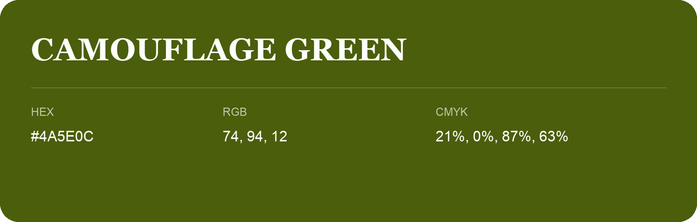

## Camouflage Green

- HEX: #4A5E0C
- RGB: 74, 94, 12
- CMYK: 21%, 0%, 87%, 63%
- Character: natural, grounded, fresh
- Suggested uses: outdoor businesses, wellness brands, organic packaging

- Source images: IMG_9071.JPG

- Data provenance: HEX recovered from page data; cross-checked against the readable source RGB.
