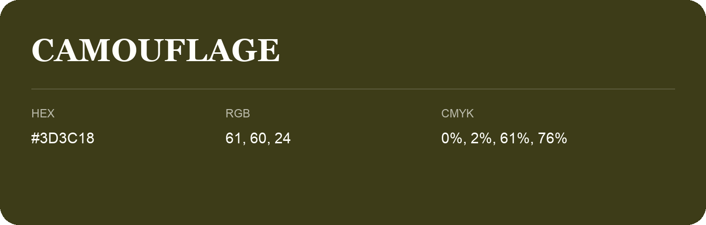

## Camouflage

- HEX: #3D3C18
- RGB: 61, 60, 24
- CMYK: 0%, 2%, 61%, 76%
- Character: deep, grounded, understated
- Suggested uses: premium packaging, editorial typography, dark backgrounds

- Source images: iCloud Photos 2/IMG_9178.JPG
