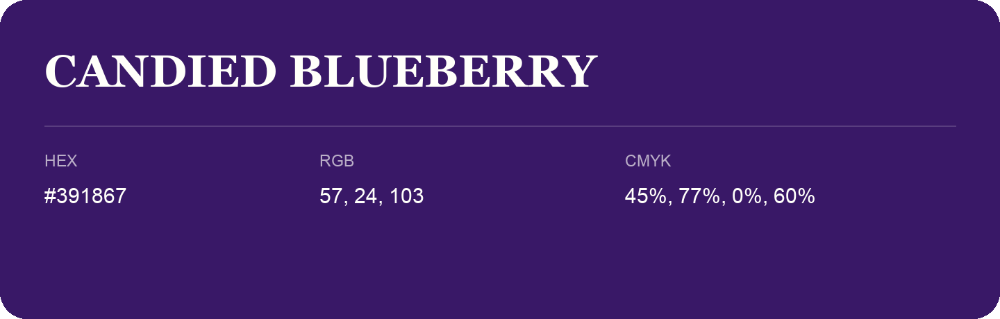

## Candied Blueberry

- HEX: #391867
- RGB: 57, 24, 103
- CMYK: 45%, 77%, 0%, 60%
- Character: expressive, imaginative, refined
- Suggested uses: beauty brands, creative businesses, distinctive accents

- Source images: IMG_9071.JPG

- Data provenance: RGB calculated from HEX, matching the page; source image RGB was unreadable.
