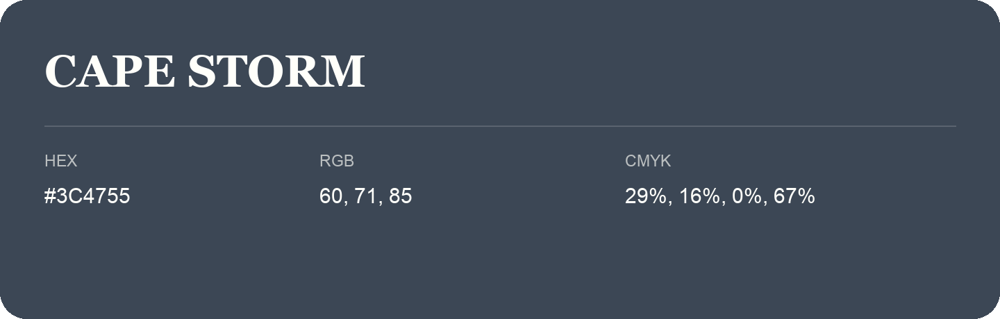

## Cape Storm

- HEX: #3C4755
- RGB: 60, 71, 85
- CMYK: 29%, 16%, 0%, 67%
- Character: deep, grounded, understated
- Suggested uses: premium packaging, editorial typography, dark backgrounds

- Source images: iCloud Photos 2/IMG_9154.JPG
