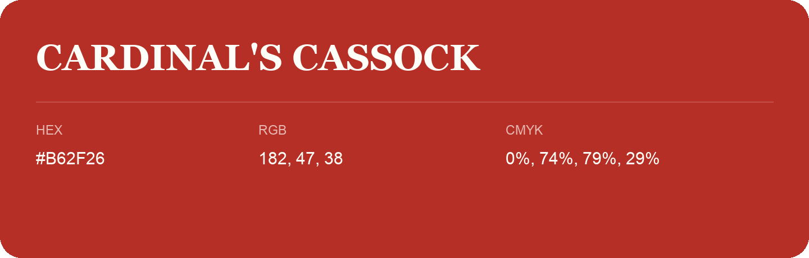

## Cardinal'S Cassock

- HEX: #B62F26
- RGB: 182, 47, 38
- CMYK: 0%, 74%, 79%, 29%
- Character: warm, expressive, energetic
- Suggested uses: food brands, expressive identities, promotional accents

- Source images: IMG_9106.JPG
