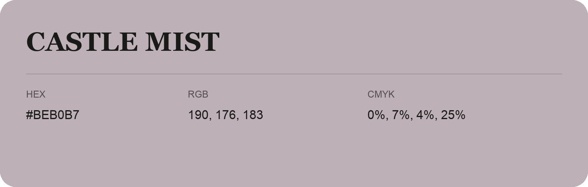

## Castle Mist

- HEX: #BEB0B7
- RGB: 190, 176, 183
- CMYK: 0%, 7%, 4%, 25%
- Character: quiet, balanced, understated
- Suggested uses: professional services, minimal identities, supporting backgrounds

- Source images: IMG_9102.JPG

- Data provenance: HEX recovered from page data; cross-checked against the readable source RGB.
