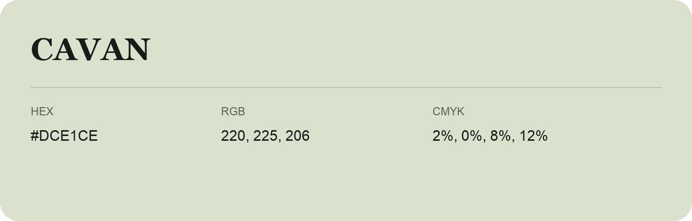

## Cavan

- HEX: #DCE1CE
- RGB: 220, 225, 206
- CMYK: 2%, 0%, 8%, 12%
- Character: quiet, balanced, understated
- Suggested uses: professional services, minimal identities, supporting backgrounds

- Source images: iCloud Photos 2/IMG_9139.JPG
