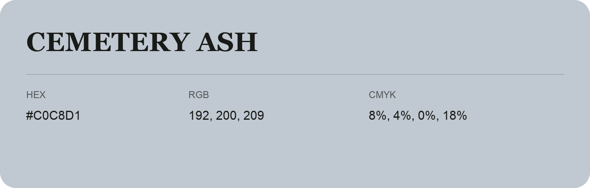

## Cemetery Ash

- HEX: #C0C8D1
- RGB: 192, 200, 209
- CMYK: 8%, 4%, 0%, 18%
- Character: quiet, balanced, understated
- Suggested uses: professional services, minimal identities, supporting backgrounds

- Source images: IMG_9034.JPG

- Data provenance: HEX recovered from page data; cross-checked against the readable source RGB.
