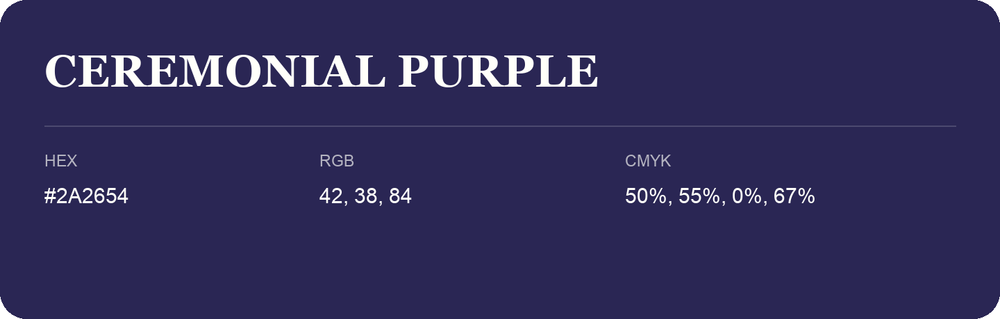

## Ceremonial Purple

- HEX: #2A2654
- RGB: 42, 38, 84
- CMYK: 50%, 55%, 0%, 67%
- Character: deep, grounded, understated
- Suggested uses: premium packaging, editorial typography, dark backgrounds

- Source images: iCloud Photos 2/IMG_9188.JPG
