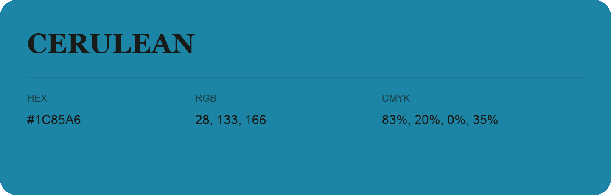

## Cerulean

- HEX: #1C85A6
- RGB: 28, 133, 166
- CMYK: 83%, 20%, 0%, 35%
- Character: calm, fresh, composed
- Suggested uses: wellness brands, coastal hospitality, modern service brands

- Source images: IMG_8985.JPG
