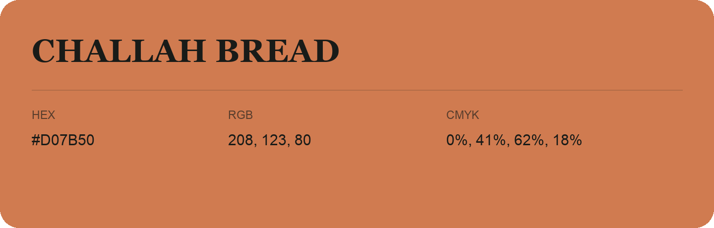

## Challah Bread

- HEX: #D07B50
- RGB: 208, 123, 80
- CMYK: 0%, 41%, 62%, 18%
- Character: earthy, rich, warm
- Suggested uses: artisan businesses, hospitality brands, warm accents

- Source images: IMG_9117.JPG
