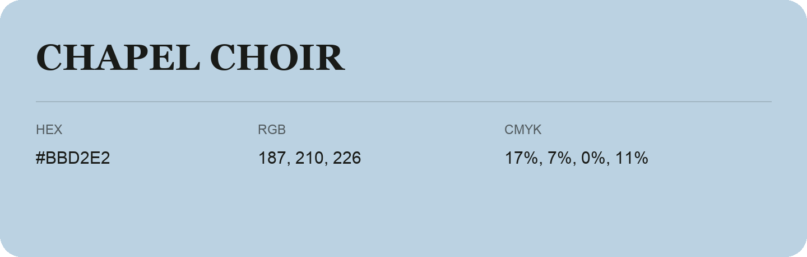

## Chapel Choir

- HEX: #BBD2E2
- RGB: 187, 210, 226
- CMYK: 17%, 7%, 0%, 11%
- Character: soft, gentle, approachable
- Suggested uses: friendly consumer brands, gentle backgrounds, welcoming accents

- Source images: IMG_9075.JPG

- Data provenance: RGB calculated from HEX, matching the page; source image RGB was unreadable.
