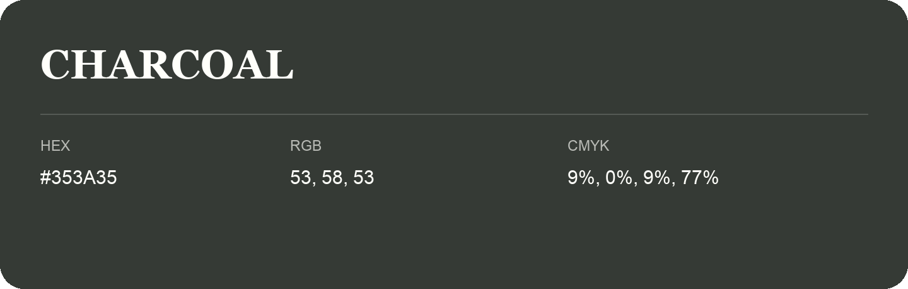

## Charcoal

- HEX: #353A35
- RGB: 53, 58, 53
- CMYK: 9%, 0%, 9%, 77%
- Character: deep, grounded, understated
- Suggested uses: premium packaging, editorial typography, dark backgrounds

- Source images: iCloud Photos 2/IMG_9189.JPG

- Name note: Other distinct shades share this name: [charcoal](charcoal.md).
