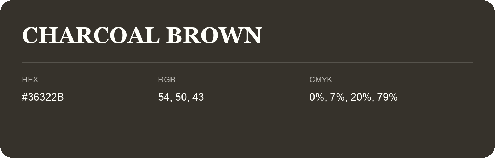

## Charcoal Brown

- HEX: #36322B
- RGB: 54, 50, 43
- CMYK: 0%, 7%, 20%, 79%
- Character: earthy, rich, warm
- Suggested uses: premium packaging, rustic brands, dark backgrounds

- Source images: IMG_8985.JPG
