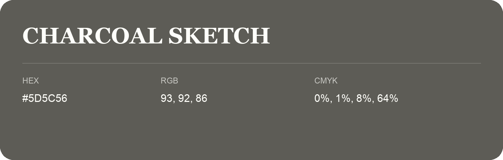

## Charcoal Sketch

- HEX: #5D5C56
- RGB: 93, 92, 86
- CMYK: 0%, 1%, 8%, 64%
- Character: restrained, grounded, sophisticated
- Suggested uses: premium brands, editorial typography, dark backgrounds

- Source images: IMG_8976.JPG
