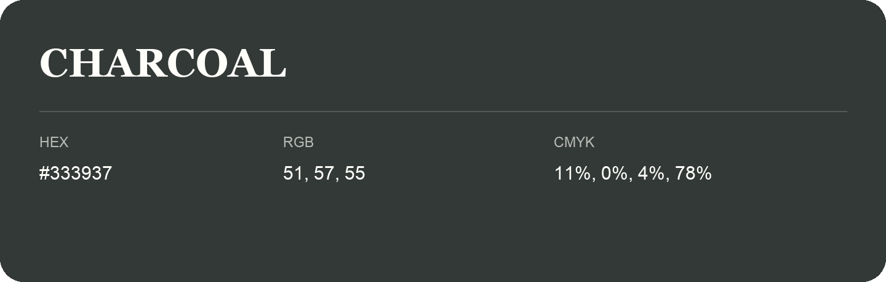

## Charcoal

- HEX: #333937
- RGB: 51, 57, 55
- CMYK: 11%, 0%, 4%, 78%
- Character: deep, grounded, understated
- Suggested uses: premium packaging, editorial typography, dark backgrounds

- Source images: iCloud Photos 2/IMG_9134.JPG

- Name note: Other distinct shades share this name: [charcoal-353a35](charcoal-353a35.md).
