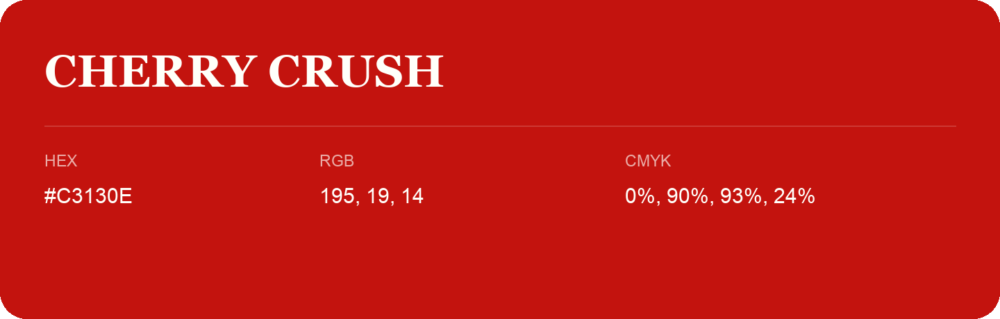

## Cherry Crush

- HEX: #C3130E
- RGB: 195, 19, 14
- CMYK: 0%, 90%, 93%, 24%
- Character: warm, expressive, energetic
- Suggested uses: food brands, expressive identities, promotional accents

- Source images: iCloud Photos 2/IMG_9125.JPG
