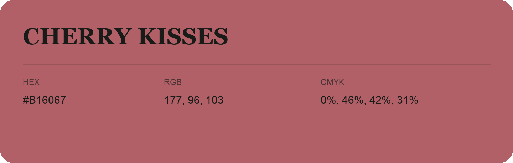

## Cherry Kisses

- HEX: #B16067
- RGB: 177, 96, 103
- CMYK: 0%, 46%, 42%, 31%
- Character: warm, expressive, energetic
- Suggested uses: food brands, expressive identities, promotional accents

- Source images: IMG_9046.JPG
