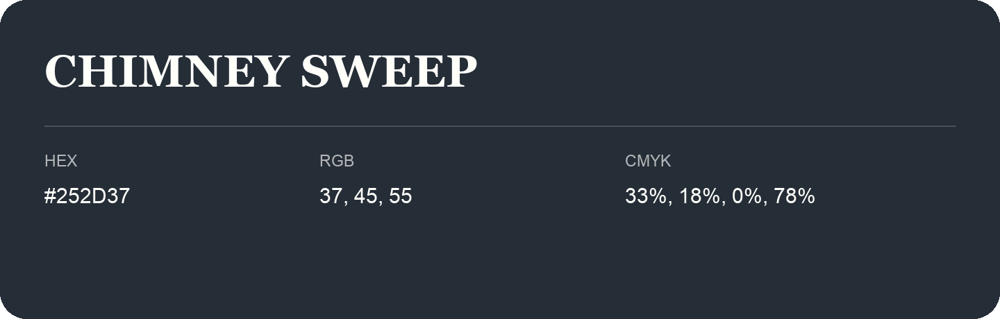

## Chimney Sweep

- HEX: #252D37
- RGB: 37, 45, 55
- CMYK: 33%, 18%, 0%, 78%
- Character: deep, grounded, understated
- Suggested uses: premium packaging, editorial typography, dark backgrounds

- Source images: iCloud Photos 2/IMG_9157.JPG
