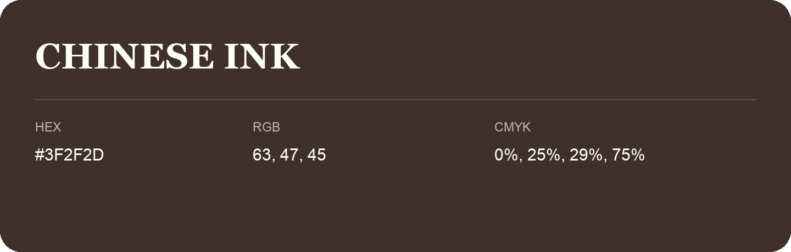

## Chinese Ink

- HEX: #3F2F2D
- RGB: 63, 47, 45
- CMYK: 0%, 25%, 29%, 75%
- Character: warm, expressive, energetic
- Suggested uses: food brands, expressive identities, promotional accents

- Source images: IMG_9016.JPG
