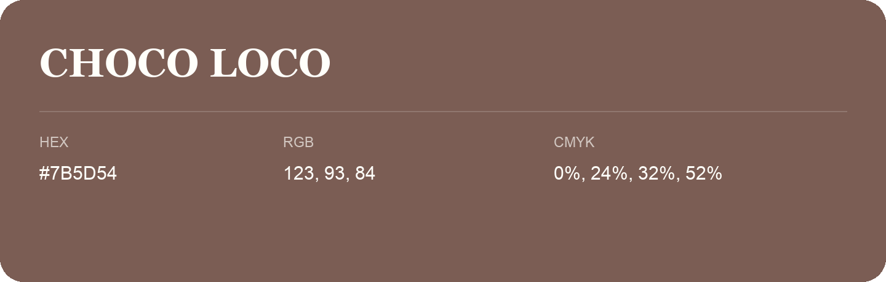

## Choco Loco

- HEX: #7B5D54
- RGB: 123, 93, 84
- CMYK: 0%, 24%, 32%, 52%
- Character: warm, expressive, energetic
- Suggested uses: food brands, expressive identities, promotional accents

- Source images: IMG_9110.JPG
