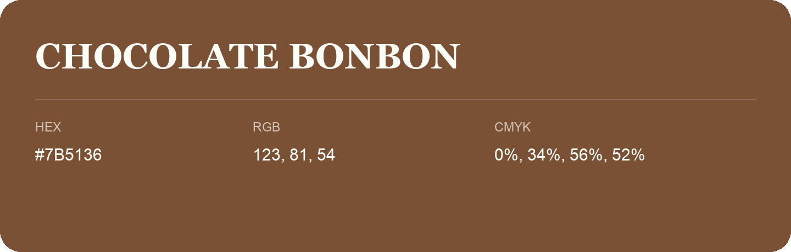

## Chocolate Bonbon

- HEX: #7B5136
- RGB: 123, 81, 54
- CMYK: 0%, 34%, 56%, 52%
- Character: earthy, rich, warm
- Suggested uses: premium packaging, rustic brands, dark backgrounds

- Source images: iCloud Photos 2/IMG_9143.JPG
