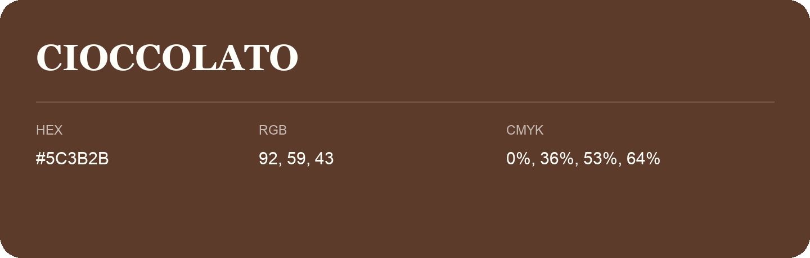

## Cioccolato

- HEX: #5C3B2B
- RGB: 92, 59, 43
- CMYK: 0%, 36%, 53%, 64%
- Character: earthy, rich, warm
- Suggested uses: premium packaging, rustic brands, dark backgrounds

- Source images: IMG_9054.JPG
