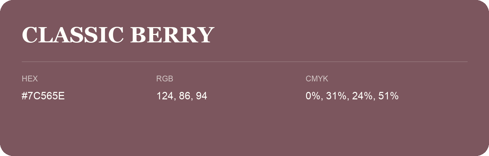

## Classic Berry

- HEX: #7C565E
- RGB: 124, 86, 94
- CMYK: 0%, 31%, 24%, 51%
- Character: warm, expressive, energetic
- Suggested uses: food brands, expressive identities, promotional accents

- Source images: IMG_9084.JPG
