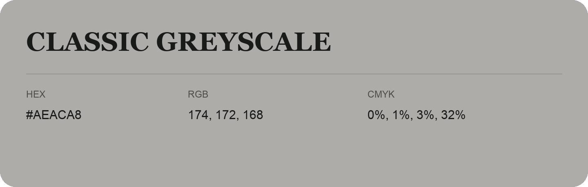

## Classic Greyscale

- HEX: #AEACA8
- RGB: 174, 172, 168
- CMYK: 0%, 1%, 3%, 32%
- Character: quiet, balanced, understated
- Suggested uses: professional services, minimal identities, supporting backgrounds

- Source images: IMG_9115.JPG
