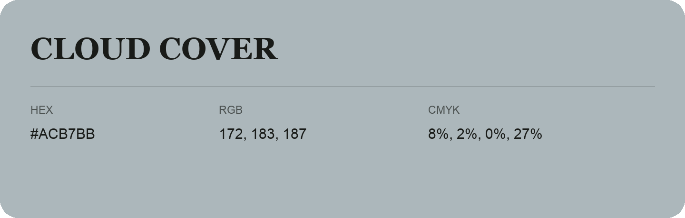

## Cloud Cover

- HEX: #ACB7BB
- RGB: 172, 183, 187
- CMYK: 8%, 2%, 0%, 27%
- Character: quiet, balanced, understated
- Suggested uses: professional services, minimal identities, supporting backgrounds

- Source images: iCloud Photos 2/IMG_9176.JPG
