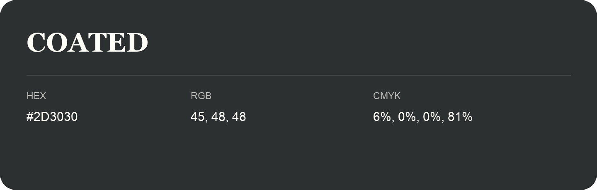

## Coated

- HEX: #2D3030
- RGB: 45, 48, 48
- CMYK: 6%, 0%, 0%, 81%
- Character: restrained, grounded, sophisticated
- Suggested uses: premium brands, editorial typography, dark backgrounds

- Source images: IMG_9032.JPG
