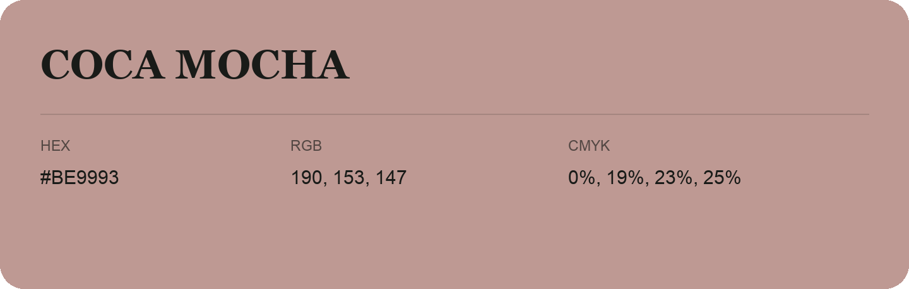

## Coca Mocha

- HEX: #BE9993
- RGB: 190, 153, 147
- CMYK: 0%, 19%, 23%, 25%
- Character: warm, expressive, energetic
- Suggested uses: food brands, expressive identities, promotional accents

- Source images: IMG_9110.JPG
