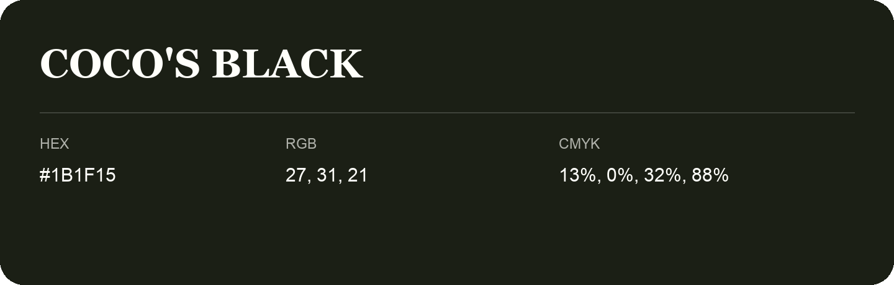

## Coco'S Black

- HEX: #1B1F15
- RGB: 27, 31, 21
- CMYK: 13%, 0%, 32%, 88%
- Character: deep, grounded, understated
- Suggested uses: premium packaging, editorial typography, dark backgrounds

- Source images: iCloud Photos 2/IMG_9161.JPG
