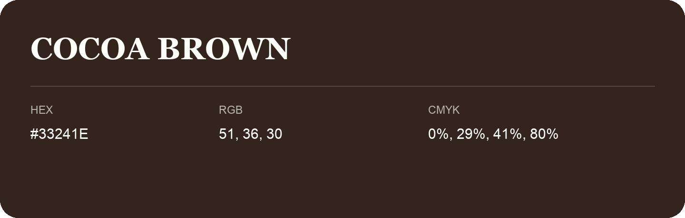

## Cocoa Brown

- HEX: #33241E
- RGB: 51, 36, 30
- CMYK: 0%, 29%, 41%, 80%
- Character: deep, grounded, understated
- Suggested uses: premium packaging, editorial typography, dark backgrounds

- Source images: IMG_9074.JPG

- Name note: Other distinct shades share this name: [cocoa-brown-34261c](cocoa-brown-34261c.md), [cocoa-brown-34271b](cocoa-brown-34271b.md).
