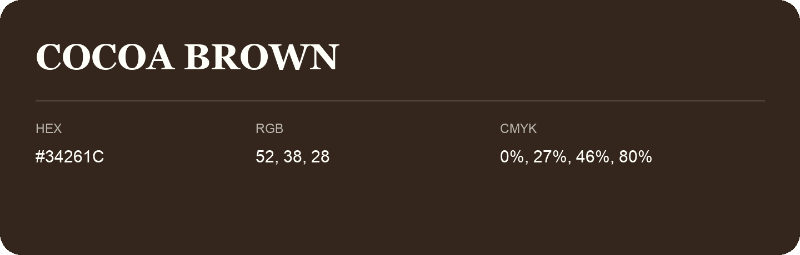

## Cocoa Brown

- HEX: #34261C
- RGB: 52, 38, 28
- CMYK: 0%, 27%, 46%, 80%
- Character: deep, grounded, understated
- Suggested uses: premium packaging, editorial typography, dark backgrounds

- Source images: IMG_9045.JPG

- Name note: Other distinct shades share this name: [cocoa-brown-33241e](cocoa-brown-33241e.md), [cocoa-brown-34271b](cocoa-brown-34271b.md).
